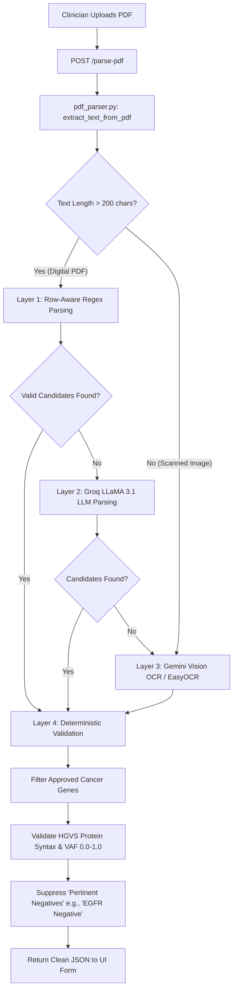

# Part 1: System Overview, Architecture & Multi-Agent Framework
## XMARs: Extended Mutation Analysis and Resistance Scoring

---

## 1. Executive Summary & Clinical Problem

### 1.1 The Clinical Challenge in Precision Oncology
Non-Small Cell Lung Cancer (**NSCLC**) accounts for approximately **85%** of all lung cancer diagnoses worldwide. The advent of Next-Generation Sequencing (NGS) and targeted molecular therapies—such as Tyrosine Kinase Inhibitors (TKIs) targeting EGFR, ALK, KRAS, and BRAF—has revolutionized early clinical outcomes.

However, oncology clinicians face two severe bottlenecks in real-world practice:
1. **Acquired Drug Resistance**: Patients almost universally develop drug resistance within 9 to 14 months due to secondary mutations (e.g., EGFR gatekeeper `T790M` or tertiary `C797S`), downstream activation of the MAPK pathway, or phenotypic bypass mechanisms (e.g., MET amplification).
2. **The Clinical "Black Box" Trap**: Traditional machine learning and deep learning models predict drug response probabilities without biological interpretability. An oncologist cannot ethically prescribe a cytotoxic or targeted regimen based on an opaque numerical score without understanding:
   - *Which specific genomic alteration drove the resistance prediction?*
   - *Which downstream biochemical signaling cascade is disrupted?*
   - *What evidence-based combination therapy can circumvent this bypass circuit?*

### 1.2 The XMARs Solution
**XMARs** is an explainable clinical decision-support system designed to solve both problems by combining:
- **Bioinformatic Feature Engineering & Ensemble Machine Learning** (Random Forest, Gradient Boosting, AdaBoost, and Soft Voting Ensemble).
- **Game-Theoretic Explainability** using exact Shapley Additive exPlanations (**SHAP** TreeExplainer).
- **A 4-Stage Multi-Agent Reasoning Architecture** where deterministic algorithms perform all mathematical and biological scoring, and an LLM functions strictly as a natural-language clinical translator.
- **Automated Diagnostic Ingestion** parsing multi-page clinical molecular diagnostic PDF reports (e.g., FoundationOne CDx, Guardant360).

---

## 2. Architectural Philosophy: Decoupled Multi-Agent Reasoning

A primary failure mode of contemporary applied AI systems in healthcare is the **"Hallucination vs. Compute" trap**. When Large Language Models (LLMs) are asked to directly calculate IC50 drug concentrations, parse high-dimensional genomic matrices, or deduce pathway activation integrals, they hallucinate non-existent dosages, invent drug-target pairs, and return uncalibrated probabilities.

XMARs strictly enforces the architectural doctrine:
> **"Deterministic Compute for Mathematics, Genomics & Scoring; LLMs Strictly for Clinical Translation."**

```
+--------------------------------------------------------------------------------------------------+
|                                    1. CLINICAL WEB PORTAL (UI)                                  |
|   • Diagnostic PDF Upload (Drag-and-Drop) OR Manual Mutation / VAF Entry Form                    |
|   • Real-Time Animated Multi-Agent Thought & Progress Console                                    |
|   • Interactive Dashboard: Risk Gauge, Dynamic SHAP Waterfall Charts, Pathway Disruption, PGx    |
+--------------------------------------------------------------------------------------------------+
                                                 |
                                                 | HTTP POST /predict-ai or /parse-pdf
                                                 v
+--------------------------------------------------------------------------------------------------+
|                              2. FLASK APPLICATION SERVER (app.py)                                |
|   • Route Handling, Request Validation & Session Management                                      |
|   • Instantiation of PipelineOrchestrator                                                        |
|   • In-Memory Singleton: DrugKnowledgeBase (621 oncology drugs, 8 canonical pathways)           |
+--------------------------------------------------------------------------------------------------+
                                                 |
          +--------------------------------------+--------------------------------------+
          |                                                                             |
          v                                                                             v
+------------------------------------+                         +------------------------------------+
|    3. PDF EXTRACTION PIPELINE      |                         |  4. DETERMINISTIC COMPUTE ENGINE   |
|                                    |                         |     (Pure Python, Scikit, SHAP)    |
| • Layer 1: Strict Regex Extraction |                         |                                    |
| • Layer 2: Groq LLaMA 3.1 LLM      |                         | • Feature Vector Construction      |
| • Layer 3: Gemini Vision OCR       |                         | • Ensemble ML Inference            |
| • Layer 4: Deterministic Validation|                         | • Polynomial SHAP TreeExplainer    |
|   (HGVS check & Negation filtering)|                         | • In-Memory Pathway Graph Traversal|
+------------------------------------+                         +------------------------------------+
                                                 |
                                                 v
+--------------------------------------------------------------------------------------------------+
|                              5. MULTI-AGENT REASONING PIPELINE                                   |
|                                   (drug_prediction/agents.py)                                    |
|                                                                                                  |
|  [Agent 1: Mutation Analyst Agent]                                                               |
|    • Evaluates Variant Allele Frequency (VAF) and clonal distribution.                           |
|    • Cross-references trained ML ensemble + SHAP feature importances.                            |
|    • Classifies variants: Likely Driver (VAF ≥ 0.3, SHAP > 0.01), Possible Driver, Passenger.    |
|                                                                                                  |
|  [Agent 2: Pathway Specialist Agent]                                                             |
|    • Maps identified driver mutations to 8 canonical oncogenic signaling pathways.               |
|    • Computes pathway disruption score (%): Disruption = (Compromised Genes / Pathway Size) * 100|
|    • Identifies pathway cross-talk and secondary bypass mechanisms.                              |
|                                                                                                  |
|  [Agent 3: Drug Strategist Agent]                                                                |
|    • Evaluates 621 oncology compounds against identified drivers and disrupted pathways.         |
|    • Categorizes compounds into Likely Sensitive vs. Likely Resistant.                           |
|    • Pinpoints bypass circuit resistance (e.g., MET amplification causing EGFR TKI failure).     |
|                                                                                                  |
|  [Agent 4: Clinical Advisor Agent]                                                               |
|    • Compiles all pre-computed, deterministic data into a strict JSON schema.                    |
|    • Sends single structured payload to Google Gemini API (gemini-2.0-flash).                    |
|    • Translates mathematical findings into an oncologist-ready clinical narrative.               |
|    • Deterministic Fallback: Reverts to local Markdown template if API quota (HTTP 429) fails.   |
+--------------------------------------------------------------------------------------------------+
                                                 |
                                                 v
+--------------------------------------------------------------------------------------------------+
|                                    6. CLIENT PRESENTATION TIER                                   |
|   • Rendered Jinja2 Results View (`results.html` / `index.html`)                                 |
|   • Plotly / D3 / Chart.js Interactive SHAP Visualizations                                       |
|   • Printable Clinical Summary Report & Exportable Diagnostic Summary                            |
+--------------------------------------------------------------------------------------------------+
```

---

## 3. The 4 Autonomous Agents in Detail

### Agent 1: Mutation Analyst Agent (`MutationAnalystAgent`)
* **Core File**: [`drug_prediction/agents.py`](file:///c:/Users/rohit/Desktop/study/AI_ML/mini%20project-XMARs/mini_project/drug_prediction/agents.py)
* **Biological Objective**: Differentiate between initiating somatic driver mutations (which drive cancer growth and confer drug resistance) and passenger mutations (neutral somatic alterations accumulated during cell division).
* **Mathematical & Algorithmic Process**:
  1. Receives input gene list and patient-specific Variant Allele Frequency values:
     $$\mathbf{M} = [(\text{gene}_1, \text{vaf}_1), (\text{gene}_2, \text{vaf}_2), \dots]$$
  2. Constructs a 14-dimensional feature vector matching `mutation_features.csv` (One-hot encoded variant types, coding status, baseline gene mutation frequency).
  3. Executes `SHAPExplainer.explain_all_models()` to calculate exact Shapley feature attributions across the Random Forest, Gradient Boosting, and AdaBoost models.
  4. Classifies each variant based on biological clonality thresholds:
     - **Likely Driver**: $\text{VAF} \ge 0.30$ AND mean SHAP attribution $> 0.01$. (High tumor clonality + high predictive impact).
     - **Possible Driver**: $0.10 \le \text{VAF} < 0.30$ OR (SHAP $> 0.01$ with subclonal VAF).
     - **Likely Passenger**: $\text{VAF} < 0.10$ AND low feature contribution.
* **Output Payload**:
  ```json
  {
    "driver_mutations": ["EGFR"],
    "passenger_mutations": ["TP53"],
    "mutation_details": {
      "EGFR": {
        "vaf": 0.45,
        "classification": "likely_driver",
        "confidence": 0.88,
        "shap_importance": 0.0342
      }
    }
  }
  ```

### Agent 2: Pathway Specialist Agent (`PathwaySpecialistAgent`)
* **Core File**: [`drug_prediction/agents.py`](file:///c:/Users/rohit/Desktop/study/AI_ML/mini%20project-XMARs/mini_project/drug_prediction/agents.py)
* **Biological Objective**: Determine the systemic cellular impact of driver mutations on 8 canonical signaling cascades:
  1. `EGFR Signaling`
  2. `MAPK/ERK Cascade`
  3. `PI3K/AKT/mTOR Cascade`
  4. `TP53 / Apoptosis Control`
  5. `Cell Cycle Progression`
  6. `DNA Damage Repair (DDR)`
  7. `RAS Signaling`
  8. `WNT / Beta-Catenin Signaling`
* **Mathematical & Algorithmic Process**:
  - Traverses the in-memory pathway graph in $O(1)$ constant time:
    $$\text{Disruption Score} = \left( \frac{|\text{Mutated Genes in Pathway}|}{|\text{Total Curated Pathway Genes}|} \right) \times 100$$
  - Identifies pathway cross-talk: If both `EGFR Signaling` and `PI3K/AKT/mTOR` are disrupted, flags concurrent bypass survival activation.
* **Output Payload**:
  - Ranked list of disrupted pathways with numeric activation percentages.
  - Identification of critical regulatory checkpoints compromised.

### Agent 3: Drug Strategist Agent (`DrugStrategistAgent`)
* **Core File**: [`drug_prediction/agents.py`](file:///c:/Users/rohit/Desktop/study/AI_ML/mini%20project-XMARs/mini_project/drug_prediction/agents.py) & [`resistance_predictor.py`](file:///c:/Users/rohit/Desktop/study/AI_ML/mini%20project-XMARs/mini_project/drug_prediction/resistance_predictor.py)
* **Biological Objective**: Evaluate sensitivity and resistance across 621 oncology compounds and recommend combination strategies.
* **Algorithmic Process**:
  - Queries `DrugKnowledgeBase` (pre-indexed table of 621 drugs, their primary protein targets, and target pathways).
  - Evaluates pharmacogenomic (PGx) resistance rules:
    - *Direct Target Inhibition*: Drug target directly matches driver mutation gene $\to$ **Likely Sensitive** (unless secondary resistance mutation present).
    - *Bypass Circuit Activation*: If a downstream pathway gene is constitutively active (e.g., `KRAS G12C` mutated downstream of `EGFR`), upstream EGFR inhibitors (e.g., Erlotinib) are marked **Likely Resistant**.
    - *Gatekeeper Alterations*: Identifies `EGFR T790M` as conferring resistance to 1st/2nd generation TKIs (Gefitinib, Afatinib) while retaining sensitivity to 3rd generation covalent TKIs (Osimertinib).
* **Output Payload**:
  - Ranked list of candidate drugs split into `Sensitive`, `Resistant`, and `Intermediate`.
  - Mechanistic rationale for each drug classification.

### Agent 4: Clinical Advisor Agent (`ClinicalAdvisorAgent`)
* **Core File**: [`drug_prediction/agents.py`](file:///c:/Users/rohit/Desktop/study/AI_ML/mini%20project-XMARs/mini_project/drug_prediction/agents.py)
* **Objective**: Generate a natural-language clinical report formatted specifically for practicing oncologists and tumor boards.
* **Execution & Fail-Safe Architecture**:
  1. Assembles a structured JSON dossier containing:
     - Patient mutation list and VAFs
     - Driver vs. passenger classifications
     - Disrupted signaling pathways and percentage scores
     - Sensitive and resistant drugs with biological mechanisms
     - SHAP top-contributing biomarker features
  2. Submits this single payload to Google Gemini (`gemini-2.0-flash` or `gemini-2.5-flash`) via the `google-genai` SDK with strict system prompt constraints:
     > *"You are an expert clinical oncology decision-support advisor. You MUST NOT invent or hallucinate data. Base your findings strictly on the structured evidence provided."*
  3. **Zero-Downtime Deterministic Fallback**:
     - If the Gemini API key is missing, network access is down, or Google returns an **HTTP 429 Quota Exceeded**, the agent automatically intercepts the exception and compiles a deterministic Markdown report using pre-built clinical templates.
     - **Result**: The clinician *never* receives a blank screen or a crashed server.

---

## 4. Multi-Stage Clinical PDF Ingestion Pipeline

To avoid manual, error-prone data entry of genetic sequencing reports, XMARs includes a 4-layer fault-tolerant PDF extraction pipeline:



### Key Engineering Safeguards in Extraction:
1. **Pertinent Negative Filtering**: Reports commonly state: *"Pertinent Negatives: EGFR, ALK, ROS1 not detected"*. A naive keyword search falsely extracts these as positive mutations. XMARs scans section headers and suppresses any gene enclosed within negative blocks.
2. **Sub-string Collision Suppression**: Normalizes descriptions like `p.R331f` vs `p.R331fs`, merging partial matches into the canonical HGVS nomenclature.
3. **Multi-Page Optical Character Recognition**: If text extraction yields $< 200$ characters, `pdf2image` rasterizes the document at 150 DPI and routes the images to Gemini Vision OCR.
